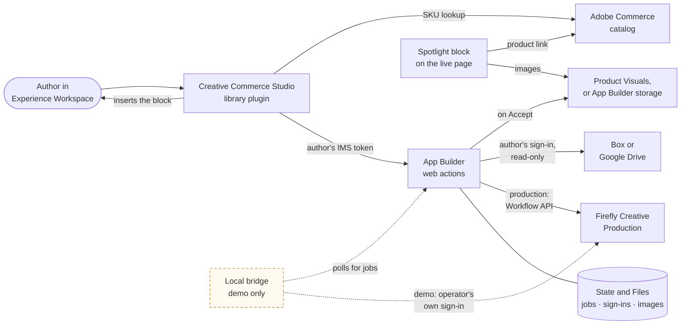
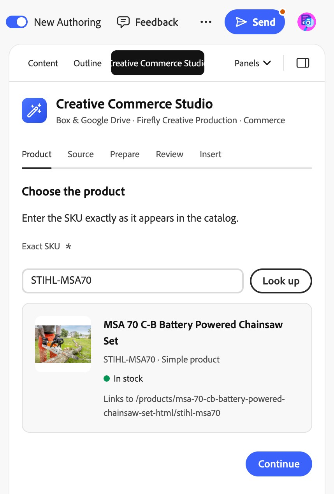
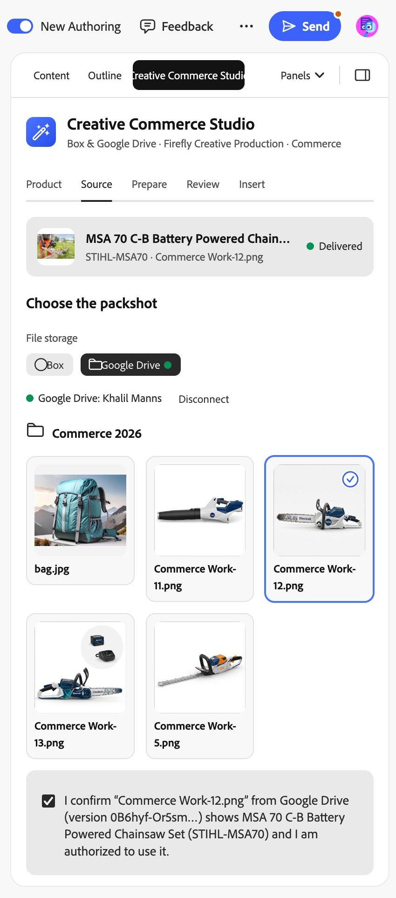
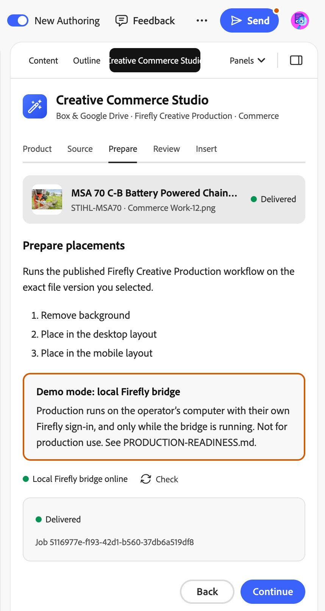
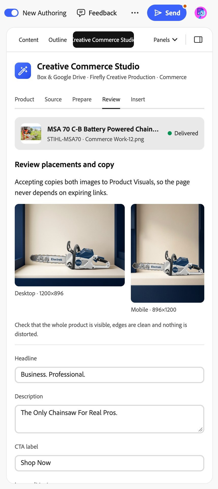
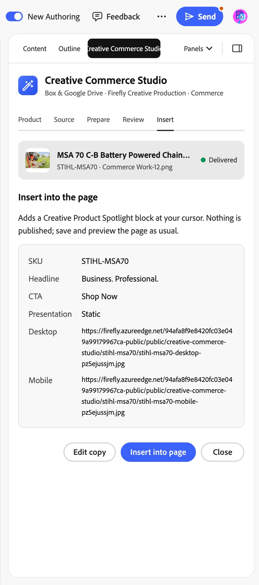

# Creative Commerce Studio

> **Standalone, marketplace-style repo:** [github.com/kmanns/creative-commerce-studio](https://github.com/kmanns/creative-commerce-studio) is the reference version of this extension (plugin, block, backend, docs). This folder is the working copy for this site.

> [!WARNING]
> **Demo build — not production-ready.** Firefly runs go through a **local bridge on the operator's computer** using that person's own Adobe sign-in. Approved images are stored in App Builder public storage, not Product Visuals. Production needs Firefly Services API access (Developer role and a server-to-server credential in the Firefly org) and an AEM server-to-server credential, among other things. **Read [PRODUCTION-READINESS.md](PRODUCTION-READINESS.md) before installing or relying on this.**

Turns product masters in **Box** or **Google Drive** into shoppable, placement-ready storefront content inside **Experience Workspace**, using **Firefly Creative Production** for the imagery and **Adobe Commerce** for the product link.



Solid lines are always used. Dashed lines are the **demo-only** local bridge. For how each connection is secured, and a step-by-step diagram of a run, see [How it works](https://github.com/kmanns/creative-commerce-studio#how-it-works) in the reference repo.

Author flow: **Product → Source → Prepare → Review → Insert**, then **New banner** to make another. The plugin only inserts the block. Publishing is still the normal Workspace action.

> **Setup check:** the top of the plugin's Product step shows what's configured and what's missing, with links to the fix.
>
> **Requirements and every value to fill in:** see [Before you start](https://github.com/kmanns/creative-commerce-studio#before-you-start) in the reference repo. It covers the application requirements, who needs which access, and each `.env` setting, credential and secret, with where to get it.

## Screenshots

The plugin in Experience Workspace's side panel, from a real end-to-end run (Google Drive → Firefly Creative Production → insert).

<table>
  <tr>
    <td align="center"><br><sub><b>1. Product</b>: exact-SKU lookup</sub></td>
    <td align="center"><br><sub><b>2. Source</b>: Box or Google Drive, confirm the file</sub></td>
    <td align="center"><br><sub><b>3. Prepare</b>: Firefly Creative Production run</sub></td>
  </tr>
  <tr>
    <td align="center"><br><sub><b>4. Review</b>: placements and copy</sub></td>
    <td align="center"><br><sub><b>5. Insert</b>: block at the cursor</sub></td>
    <td></td>
  </tr>
</table>

## Video walkthrough

https://github.com/user-attachments/assets/f4f1c8ff-22bf-4bd1-8d05-bd5e54fbb888

A 7:06 walkthrough, recorded on 2026-11-19. It shows the Commerce storefront, then Creative Commerce Studio in Experience Workspace, including choosing a **Campaign Look** on the Prepare step and running it through the local Firefly bridge. If the player doesn't appear, [open the video directly](https://github.com/user-attachments/assets/f4f1c8ff-22bf-4bd1-8d05-bd5e54fbb888).

## Status

| Part | State |
|------|-------|
| Spotlight block | Built and browser-tested: desktop/mobile, missing SKU, reduced motion, long copy |
| Workspace plugin | Built and tested in a simulated Workspace frame with a mocked backend |
| App Builder actions | Built, unit-tested (`npm test`, 83 tests). Stage deploy verified in Workspace |
| Box | Connect + folder listing verified in Workspace (2026-11-11); end-to-end runs 2026-11-13 |
| Google Drive | End-to-end runs verified in Workspace |
| FFCPE | Workflow contract verified with a real MCP run (2026-11-12). Hosted sign-in refused by Adobe policy; **demo runs via the local bridge**; production needs the api credential |
| Product Visuals | Needs an AEM server-to-server credential; until then delivery uses App Builder public storage |

## Prerequisites

- Adobe Developer Console project with an App Builder workspace, plus the `aio` CLI on the machine that deploys.
- Firefly Creative Production entitlement and a published workflow (see [workflows/README.md](workflows/README.md)).
- AEM Assets as a Cloud Service environment behind Commerce **Product Visuals**, with **Dynamic Media with OpenAPI** delivery.
- A Box account (a free developer account works) and permission to create an OAuth app.
- An authorized packshot you are allowed to use (and distribute, if it goes in a public repo).

## 1. Box app

1. In the Box Developer Console, create a **Custom App → User Authentication (OAuth 2.0)**.
2. Scopes: **Read all files and folders**. Writing is not needed; the backend never writes to Box.
3. Redirect URI: `https://<namespace>.adobeioruntime.net/api/v1/web/creative-commerce-studio/box-auth-callback`. It must match `BOX_REDIRECT_URI` exactly.
4. Copy the client ID and secret into your App Builder `.env`, never into chat or git.
5. Create a campaign folder, add authorized packshots, and put its numeric ID (from the folder URL) in `BOX_ALLOWED_FOLDER_ID`. Authors can browse only this folder and its subfolders.
6. If your Box enterprise restricts third-party apps, a Box admin must authorize the app.

## 1b. Google Drive (optional second source)

Authors pick **Box** or **Google Drive** on the Source step. Drive is offered only when all four `GDRIVE_*` settings are set. It follows the same rules as Box: read-only, one allowed folder tree, the exact revision is sent to Firefly, and tokens are encrypted per author.

1. In **Google Cloud Console** (console.cloud.google.com), create or select a project, then **APIs & Services → Library → Google Drive API → Enable**.
2. **OAuth consent screen**: user type **External**, publishing status **Testing**. Add the scope `…/auth/drive.readonly` and add your Google account under **Test users**.
3. **Credentials → Create credentials → OAuth client ID → Web application**. Under **Authorized redirect URIs**, add `https://<namespace>.adobeioruntime.net/api/v1/web/creative-commerce-studio/gdrive-auth-callback`.
4. Put the client ID and secret into `.env` as `GDRIVE_CLIENT_ID` / `GDRIVE_CLIENT_SECRET`, with `GDRIVE_REDIRECT_URI` set exactly as registered.
5. Create a Drive folder with authorized packshots (PNG/JPEG). Its ID is the last part of the folder URL (`https://drive.google.com/drive/folders/<ID>`); put it in `GDRIVE_ALLOWED_FOLDER_ID`.
6. `aio app deploy --force-deploy`.

Testing-mode limits: Google sign-ins for unverified apps in Testing expire after **7 days** (authors reconnect), and only listed test users can sign in. Company Google Workspace accounts may block unverified apps; a personal Google account works. See [PRODUCTION-READINESS.md](PRODUCTION-READINESS.md) for what production use requires.

## 2. Firefly Creative Production

Build and publish the workflow first ([workflows/README.md](workflows/README.md)). Then pick a mode:

**`FFCPE_MODE=bridge` — DEMO ONLY, works today.** See [Local Firefly bridge](#local-firefly-bridge-demo-only) below.

**`FFCPE_MODE=mcp` — hosted sign-in, currently refused by Adobe.** The backend is an MCP client of `https://run-workflow.adobe.io/mcp`. Each author clicks **Connect Firefly** on the Prepare step and signs in with their own Adobe account, which must be able to run the workflow. The first sign-in after a deploy registers this backend with Adobe's MCP sign-in server (OAuth dynamic client registration); that creates a client record on Adobe's side. Settings:

- `FIREFLY_REDIRECT_URI`: the backend URL followed by `/firefly-auth-callback`
- `FFCPE_WORKFLOW_ID` and the node IDs `FFCPE_PRODUCT_NODE_ID`, `FFCPE_DESKTOP_NODE_ID`, `FFCPE_MOBILE_NODE_ID` (see the workflow's Execute Graph snippet). Outputs are matched by node ID, never by file name or order.

The run-workflow MCP only accepts sign-ins from local tools or Claude's hosted callback. A hosted backend gets `redirect_uri must be a loopback (localhost) URL or the Claude hosted callback`, which the plugin shows as a clear message. This mode only works if Adobe allowlists the backend's callback URL.

**`FFCPE_MODE=api`.** REST Workflow API (`POST /batch/execute`, status, executions; contract in `https://run-workflow.adobe.io/openapi.json`) with an OAuth Server-to-Server credential. This needs Developer access in the org that owns the workflow. Set `FFCPE_CLIENT_ID`, `FFCPE_CLIENT_SECRET`, `FFCPE_IMS_ORG_ID` and, if your credential requires it, `FFCPE_IMS_USER_ID`. The request body follows the published workflow's generated API request: `{ "workflow": { "workflowId" }, "inputs": [{ "node_id", "content": [{ "sourceUrl", "name" }] }] }`, with one input per node (the product photo, then any scene images). `FFCPE_EXECUTE_TEMPLATE` can replace the body, but only for workflows whose only input is the product photo.

In both modes the workflow gets a 1-hour presigned App Builder Files URL to the exact Box file version (Box links aren't accepted as workflow input hosts).

## Choosing a workflow

Authors choose the Firefly Creative Production workflow on the **Prepare** step, from a list the site admin configures. With several workflows, they appear as radio buttons, each showing its description and steps. With one, the step just shows its name.

### The workflow list

Keep the list in `workflows.json`, a JSON array where the first entry is the default. Upload it with `npm run workflows:upload` (see below). Changes apply to the next run, with no redeploy. Each entry is one choice authors see:

| Field | Required | Meaning |
|---|---|---|
| `key` | yes | Short ID: lowercase letters, digits, dashes |
| `label` | yes | Name authors see |
| `description`, `steps` | no | One-line description and a list of step names shown under the choice |
| `workflowId` | yes | The **published** workflow's execution ID, not the editable Builder source's ID |
| `productNodeId` | yes | The image input that receives the author's product photo |
| `desktopNodeId`, `mobileNodeId` | yes | The final desktop and mobile composite nodes. Outputs are picked by these node IDs, never by order or file name |
| `inputs` | no | Fixed images sent with every run of this entry, such as a scene background and its placement mask. Each has `nodeId`, `file` (a path under `looks/`), an optional `role` (`desktop-background`, `desktop-mask`, `mobile-background`, `mobile-mask` or `other`) and optional `width` and `height` |

Where the list comes from, first match wins:

1. `FFCPE_WORKFLOWS` in `.env`, a one-line JSON array in the same format. It needs `aio app deploy --force-deploy` after each change, and the upload command warns if it's set, because it hides the uploaded list.
2. The uploaded `workflows.json`.
3. A single workflow from `FFCPE_WORKFLOW_ID` and the three `FFCPE_*_NODE_ID` values, with an optional `FFCPE_WORKFLOW_LABEL`. Existing installs keep working unchanged.

### Workflows with scene images (for example Campaign Looks)

Some workflows need more than the product photo. A "Campaign Looks" workflow, for instance, composites the product into a pre-approved scene, and it needs that scene's desktop and mobile **background** plus a **placement mask** for each. In the list, make **one entry per look**. Every entry uses the same `workflowId` and node IDs, and its own four `inputs`:

```json
{
  "key": "look-workshop",
  "label": "Campaign Look: Workshop",
  "workflowId": "<published-workflow-id>",
  "productNodeId": "<product-photo-input-node>",
  "desktopNodeId": "<desktop-composite-node>",
  "mobileNodeId": "<mobile-composite-node>",
  "inputs": [
    { "nodeId": "<desktop-background-input-node>", "file": "looks/workshop/workshop-desktop-background.jpg", "role": "desktop-background" },
    { "nodeId": "<desktop-mask-input-node>", "file": "looks/workshop/workshop-desktop-mask.png", "role": "desktop-mask" },
    { "nodeId": "<mobile-background-input-node>", "file": "looks/workshop/workshop-mobile-background.jpg", "role": "mobile-background" },
    { "nodeId": "<mobile-mask-input-node>", "file": "looks/workshop/workshop-mobile-mask.png", "role": "mobile-mask" }
  ]
}
```

Authors only pick the product, the photo and the look. The scene images stay hidden:

- **Storage:** they're kept in the backend's **private** App Builder storage, never under `public/`.
- **Links:** every run gets fresh 1-hour links to them.
- **Each run is one product with one look.** Don't put several looks' images into one entry: the workflow could pair them up in unintended combinations.

**Upload the list and the images** from the backend folder on your computer, the same folder you deploy from. The command uploads **through the deployed backend**: the backend hands out 10-minute upload links, so your computer needs no storage credentials. It needs `CCS_BACKEND_URL` plus a token in that folder's `.env`:

- **Bridge mode:** the existing `BRIDGE_TOKEN` works.
- **Otherwise:** set `ADMIN_TOKEN`, 32+ random characters (for example from `openssl rand -hex 32`), and redeploy.

Without those settings, or with `--direct`, it writes straight to App Builder storage using the `AIO_runtime_*` values that `aio app use` writes.

1. Put each image at its `file` path under `looks/`, for example `looks/workshop/workshop-desktop-mask.png`. Give every file a unique name, such as the look's name followed by its part, so they can't be mixed up in Firefly either. Images in that folder aren't committed.
2. `npm run workflows:check` validates the list and every image and uploads nothing. It checks that:
   - every file is present and really is a PNG or JPEG, and its extension matches its real type: renaming a `.png` to `.jpg` doesn't convert it
   - masks are PNG
   - each mask is exactly the size of its channel's background
   - any `width` or `height` you gave matches the file
3. `npm run workflows:upload` runs the same checks, then uploads the images, and the list last.

The backend repeats those checks **before every run**, so a missing or wrong image stops the run with a clear message before anything reaches Firefly. Scene images for the Campaign Looks contract are 1200 × 896 for desktop and 896 × 1200 for mobile, and the masks are opaque grayscale PNGs: white marks where the product goes, black protects the rest.

### How runs behave

- **Each job records its workflow:** key, name, workflow ID, node IDs and scene image paths. Polling, the local bridge and result matching all use that job's workflow, even if the list changes later. The Insert step shows which workflow made the images.
- **Desktop and mobile succeed or fail on their own.** If only one composite comes back, it's kept and shown on the Prepare step next to the channel that failed, with the reason. Accepting needs both, so the author runs again for a new pair. Firefly runs aren't idempotent: a retry is a new, possibly billable, run.
- **Changing the choice after a run** marks that run as belonging to the other workflow; **Run again** starts one for the new choice. Duplicate-run protection is per workflow.
- **The backend refuses any workflow key that isn't on the list,** before anything is downloaded. The plugin never sees node IDs or file paths.
- **The local bridge must be up to date for scene images.** A bridge from before scene images were supported only sends the product photo. Those runs stop with "The local Firefly bridge is out of date". Update the backend folder and restart `npm run bridge`.
- **The list is curated on purpose.** Each workflow must produce desktop and mobile composites at known nodes, and Firefly doesn't say which nodes those are, so authors can't pick arbitrary workflows from their Firefly account.

## Local Firefly bridge (DEMO ONLY)

Adobe allows `localhost` sign-ins for tools that run on your own computer. The bridge is such a tool: it runs on the **operator's** computer, signs in with **their** Adobe account, and runs the queued jobs. Authors use the plugin as usual; with `FFCPE_MODE=bridge` the Prepare step shows a "Demo mode" notice and whether the bridge is online.

1. Add these to the backend `.env`, then `aio app deploy`:
   ```
   FFCPE_MODE=bridge
   BRIDGE_TOKEN=<32+ random characters, e.g. node -e "console.log(require('crypto').randomBytes(32).toString('base64url'))">
   CCS_BACKEND_URL=https://<namespace>.adobeioruntime.net/api/v1/web/creative-commerce-studio
   ```
   (`CCS_BACKEND_URL` is only read by the bridge.)
2. One-time sign-in on the operator's computer, in this folder: `npm run bridge:login`. A browser window opens Adobe's sign-in, which comes back to `http://localhost:8765/callback`. The sign-in is stored in `~/.ccs-bridge/firefly.json` (readable only by you).
3. Keep `npm run bridge` running during demos. It polls the backend every 5 s, starts queued runs with `run_workflow_submit`, forwards `run_workflow_get_status` results, and the backend matches outputs by node ID.

How it behaves:
- The bridge only makes outgoing HTTPS calls (to Adobe and to the backend). The backend's `bridge-next` / `bridge-report` actions require `BRIDGE_TOKEN`, compared in constant time, and refuse every call unless `FFCPE_MODE=bridge`.
- A run is handed to the bridge once. If it never confirms the start within 10 minutes, the job becomes `submit-uncertain` and is never resubmitted automatically.
- Every run uses the operator's Firefly identity, permissions and quota, for every author. See [PRODUCTION-READINESS.md](PRODUCTION-READINESS.md).

## 3. Delivery of approved images

`DELIVERY_MODE=public` (the default when no AEM credential is set) stores approved renditions under App Builder Files `public/creative-commerce-studio/<sku>/` and inserts their public URLs. They are durable and need no extra credential, but they aren't managed assets.

`DELIVERY_MODE=aem` delivers to Product Visuals:

1. In Developer Console, add an OAuth Server-to-Server credential with AEM API access for your AEM Cloud Service environment. Make sure the environment allows that client. Put the credential and scopes in `AEM_CLIENT_ID`, `AEM_CLIENT_SECRET` and `AEM_SCOPES`.
2. Set `AEM_AUTHOR_URL` / `AEM_DELIVERY_URL` (`author-p…-e…` / `delivery-p…-e…`).
3. Renditions go to `AEM_TARGET_FOLDER/<sku>/` and are marked `dam:status=approved` so Dynamic Media can deliver them. No Commerce SKU metadata is written, so they never become catalog product images.

## 4. Deploy the actions

```bash
cd app-builder/creative-commerce-studio
npm install -g @adobe/aio-cli
aio login
aio app use --global        # or: aio app use <downloaded workspace JSON>; choose "merge" for .env
# then append the variables from .env.example to the .env that aio created (keep the AIO_ lines)
npm install
npm test
aio app deploy
```

> **After changing only `.env`, run `aio app deploy --force-deploy`.** A plain deploy skips actions whose code hasn't changed, and settings live at package level, so a changed value (for example `BRIDGE_TOKEN`) may not reach the deployed actions.

The deploy prints the action URLs. Your backend base URL is everything before the action name, for example `https://<namespace>.adobeioruntime.net/api/v1/web/creative-commerce-studio`.

## 5. Point the site at the backend

In the site's `config.json` (`public.default`):

```json
"creative-commerce-studio": { "backend-url": "https://<namespace>.adobeioruntime.net/api/v1/web/creative-commerce-studio" }
```

The plugin reads the URL only from the site config, never from its own URL, so the author's token can only go to the configured host. Add every origin that loads the plugin to `ALLOWED_ORIGINS`. Experience Workspace loads library plugins through its preview proxy, so inside Workspace the plugin runs on `https://<branch>--<site>--<org>.preview.da.live` (for example `https://main--electrek-home--kmanns.preview.da.live`), not on the `.aem.page` host. List that origin, `https://da.live`, and the site preview/live hosts. If you register the plugin with a `ref` (branch), add that branch's `preview.da.live` origin too.

## 6. Register the plugin in Experience Workspace

Site config `https://da.live/config#/<org>/<site>/` → **library** sheet, add a row:

| title | description | image | path | ref |
|-------|-------------|-------|------|-----|
| Creative Commerce Studio | Box or Google Drive packshot → FFCPE → shoppable spotlight | `https://main--<site>--<org>.aem.page/tools/creative-commerce-studio/icon.svg` | `https://main--<site>--<org>.aem.page/tools/creative-commerce-studio/creative-commerce-studio.html` | |

For local development, use `ref=local`. Workspace then loads the plugin from `http://localhost:3000`.

## 7. Block

`blocks/creative-product-spotlight/` deploys with the site code. See its [README](../../blocks/creative-product-spotlight/README.md) for the content model. Demo SKUs that exist in the catalog today: `STIHL-BGA200`, `STIHL-HSA60`.

## Security model

- **Author identity:** every call carries the author's Workspace IMS token. The backend validates it with IMS (`IMS_ALLOWED_CLIENT_IDS`, optional `IMS_ALLOWED_ORGS`) and keys all data by that user. There is no shared "current user".
- **Box and Firefly tokens:** stored AES-256-GCM-encrypted in App Builder State, bound to the user, and never sent to the browser. Refreshes are serialized per user, and a revoked refresh token asks the author to reconnect. Firefly sign-in uses PKCE; the verifier never leaves the backend.
- **OAuth state:** one-time, 10-minute, bound to the author who started the flow.
- **Action inputs:** marked `final`, so request parameters cannot override configuration. CORS is limited to `ALLOWED_ORIGINS`.
- **Processing files:** source and output files live in App Builder Files. Only short-lived presigned URLs leave the backend: 1 h for FFCPE input, 15 min for previews.
- **Published page:** contains only the SKU, copy and delivery URLs (random file tokens). No Box links, Firefly output links, job IDs or account IDs.

## Job behaviour

- States: `queued → processing → ready-for-review → accepted`, plus `render-failed`, `delivery-failed`, `cancelled` and `submit-uncertain`.
- One request ID maps to one job, and an active job for the same SKU and file version is reused, so double clicks don't start duplicate paid runs.
- A network failure after sending becomes `submit-uncertain` and is never retried automatically.
- Jobs are kept for 30 days and are listed under **Your recent jobs**, so closing the plugin doesn't strand a completed job.

## Troubleshooting

| Symptom | Cause / fix |
|---------|-------------|
| "backend is not configured" | Set `creative-commerce-studio.backend-url` in the site config |
| 403 `origin-not-allowed`, or "The backend could not be reached" in Workspace while the backend is up | The plugin's origin isn't in `ALLOWED_ORIGINS`. In Workspace that is the `…preview.da.live` proxy origin. Add it and run `aio app deploy` |
| "token was not issued to Experience Workspace" | Add the Workspace client ID to `IMS_ALLOWED_CLIENT_IDS` |
| Box popup closes but stays disconnected | Redirect URI mismatch or the enterprise hasn't authorized the app. Check the `box-auth-callback` logs (`aio app logs`) |
| `box-folder-not-allowed` | The file is outside `BOX_ALLOWED_FOLDER_ID` |
| Google shows "Error 400: redirect_uri_mismatch" | `GDRIVE_REDIRECT_URI` isn't exactly one of the OAuth client's Authorized redirect URIs |
| Google shows "Access blocked: app has not completed verification" | Add your account under OAuth consent screen → Test users (Testing mode), or use a personal Google account |
| `gdrive-folder-not-allowed` | The file or folder is outside `GDRIVE_ALLOWED_FOLDER_ID` |
| Google Drive keeps asking to reconnect after a week | Expected in Testing mode (7-day sign-ins); production needs a verified app |
| "Adobe doesn't let hosted apps sign in to Firefly…" | Expected in `mcp` mode (Adobe policy). Use `bridge` for demos or `api` with a credential |
| "Local Firefly bridge offline" in the plugin | Start `npm run bridge` on the operator's computer; queued runs then start automatically |
| Bridge prints "Not signed in" or "Sign-in expired" | Run `npm run bridge:login` again |
| Bridge prints "Backend bridge-next: Bridge token rejected" | The deployed `BRIDGE_TOKEN` differs from `.env`. Run `aio app deploy --force-deploy` (a plain deploy can skip unchanged actions), then `npm run bridge` |
| "Adobe's Firefly sign-in did not accept this app's registration" | The MCP sign-in server refused dynamic registration for this redirect URI. Use `api` mode, or check `FIREFLY_REDIRECT_URI` |
| Connect Firefly window closes but stays disconnected | Check `aio app logs` for `firefly-auth-callback`; the Adobe account may lack access to the workflow |
| "… is missing scene images in backend storage" | Put the images under `looks/` at the paths in `workflows.json` and run `npm run workflows:upload` |
| `workflows:upload`: "unauthorized access to the storage service" | Direct upload was refused. Set `CCS_BACKEND_URL` and `BRIDGE_TOKEN` (bridge mode) or `ADMIN_TOKEN` in `.env`, deploy, and upload again, which then goes through the backend |
| `workflows:upload`: "The backend refused the upload … HTTP 404" | The backend predates the upload action: run `aio app deploy --force-deploy` first |
| "The local Firefly bridge is out of date" | Update the backend folder and restart `npm run bridge`; older bridges only send the product photo |
| `ffcpe-error … rejected the request` | Wrong workflow ID or node ID, the workflow isn't published, or (api mode) the request body doesn't match |
| "desktop/mobile composites were not found (output nodes: …)" | The listed node IDs are what came back; set `FFCPE_DESKTOP_NODE_ID` / `FFCPE_MOBILE_NODE_ID` to the composite nodes |
| `delivery-pending` | Asset approved but Dynamic Media isn't serving it yet. Retry Accept after a minute |
| CTA missing on the page | The SKU isn't in this store view (`data-product-status="not-found"` on the block) |

## Disconnect and clean up

- Authors use **Disconnect** in the plugin: for Box it revokes and deletes the token; for Firefly it deletes the stored sign-in.
- Job records expire after 30 days.
- Remove delivered renditions in AEM Assets under `AEM_TARGET_FOLDER`.

## Known limitations

- Single Box connector, single store view, exact-SKU lookup, PNG/JPEG only, workflows limited to an admin-curated list (see [Choosing a workflow](#choosing-a-workflow)).
- MCP mode depends on the run-workflow MCP's sign-in and tool contract (`run_workflow_submit`, `run_workflow_get_status`), which may change; api mode is the stable route.
- Insertion only; the plugin cannot read or replace existing blocks.
- Price is not shown in the spotlight. The block links to the PDP, where pricing uses the storefront's customer context.
